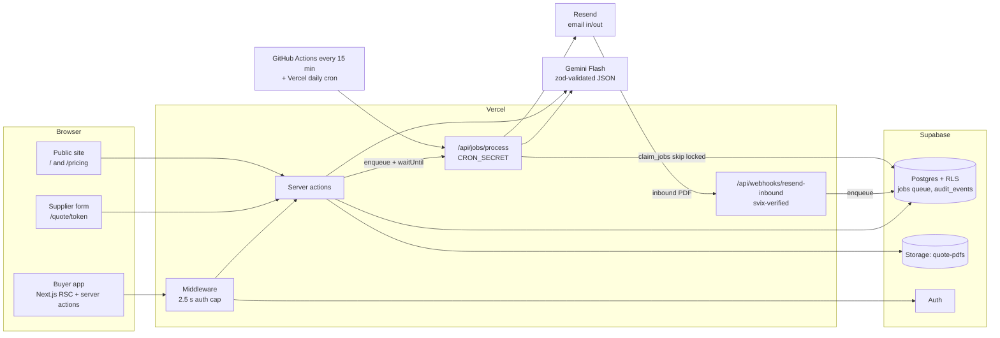

# Clarix

**Arabic-first RFQ and quote comparison for Saudi businesses.** Send a request for quotation,
collect supplier quotes by web form or emailed PDF, compare them line by line excluding VAT, and
auto-approve the best one within rules the buyer sets. Every step is recorded on a decision trail.

> Screenshots: add `docs/screenshots/landing.png`, `compare.png`, `dashboard.png` and
> `supplier-form-ar.png`. The live demo needs no sign-up: open the site and press
> **Explore the live demo**.

<!--  -->
<!--  -->

---

## The problem

A Saudi contractor or office manager who buys every week runs the same loop by hand:
1. Email several suppliers.
2. Chase replies.
3. Retype PDF quotes into a spreadsheet. The quotes come in Arabic or English, sometimes with VAT
   included and sometimes not, sometimes with only a line total.
4. Pick a winner and email a purchase order.

Nobody records why that supplier won, the spreadsheet is never the same twice, and the cheapest
quote isn't always the right one.

## The solution

Clarix turns the loop into one flow, in Arabic or English, right to left where it should be:

1. **Send the RFQ.** Type it, or paste an email and let Gemini fill the form. Each supplier gets a
   private link in their own language.
2. **Collect quotes.**
   - Suppliers answer a short form (no account), or reply to the email with a PDF.
   - The Resend inbound webhook hands the PDF to Gemini, which extracts every line excluding VAT
     and says when it had to remove VAT.
3. **Compare.**
   - Quotes appear side by side, with each supplier's price history and the market average.
   - There is an AI recommendation weighted by the buyer's priorities, and a supplier scorecard.
4. **Approve.** If the AI's pick passes the buyer's rules (delivery days, spend limit, minimum
   supplier score, warranty, cheapest-only), Clarix approves it and emails the PO. Otherwise the
   RFQ waits for the buyer, with the reason. Above the spend limit, a manager decides.
5. **Measure and negotiate.**
   - The dashboard reports savings against the average of the other quotes.
   - Reports export to CSV and print.
   - Negotiation drafts ask a supplier for a better price without leaking competitors' numbers.

## Architecture



- **Each buyer account is a tenant.** Every row hangs off `auth.uid()` through RLS. The demo
  account is read-only at the database.
- **Slow work runs as durable jobs.** It is recorded in Postgres before the response is sent,
  started immediately with `waitUntil`, and swept every 15 minutes. `claim_jobs` uses
  `for update skip locked`, so runs never collide.
- **Gemini output never goes straight into the database.** It is validated with zod and gets one
  repair attempt. If it still fails, the quote is marked "needs manual entry" and the buyer is
  notified.

More detail: [`docs/ARCHITECTURE.md`](docs/ARCHITECTURE.md), [`docs/SECURITY.md`](docs/SECURITY.md),
[`docs/DECISIONS.md`](docs/DECISIONS.md) (75 numbered decisions), and [`DESIGN.md`](DESIGN.md).

## Tech stack, and why

| Choice | Why |
| --- | --- |
| **Next.js 14 App Router** | Server components read through RLS with the user's cookie, and server actions keep every write on the server. One deployable runs the buyer app, the public supplier form, webhooks and the job runner. |
| **Supabase** (Postgres, RLS, Auth, Storage) | Tenancy enforced by the database, not by `where` clauses someone forgets. Postgres also hosts the job queue and rate limits, so there is no extra infrastructure. |
| **Gemini Flash** via `@google/genai` | Reads scanned PDFs natively, handles Arabic, supports structured output, and has a free tier for a pre-revenue product. The model is `GEMINI_MODEL`, which matters: see the challenges below. |
| **Resend** | Outbound invitations and POs plus inbound email in one service. The inbound webhook makes "reply with your PDF" work. |
| **next-intl, cookie-based** | Full Arabic/English without locale URLs, so every existing link (emails, supplier tokens, webhooks) keeps working. The language follows the buyer across devices through `profiles.locale`. |
| **Tailwind and shadcn/ui** (Radix) | Accessible primitives. Logical properties (`ms`, `ps`, `start`, `end`) make RTL a direction flip, not a second stylesheet. |
| **Vitest and PGlite** | 701 tests. Migrations and RLS are tested against real Postgres in WASM, with no Docker and no hosted database. Gemini and Resend are always mocked. |
| **Vercel and GitHub Actions** | Hobby-tier hosting. CI runs typecheck, lint, tests, the offline evals and the build on every PR, and a free schedule sweeps the job queue. |

## Engineering challenges

**1. Background work that silently never happened.** The supplier form, manual entry and PDF
confirmation called `maybeAutoGenerateRecommendation()` without `await`. On a laptop that works.
On a serverless platform the function freezes as soon as the response is sent, so the
recommendation, the auto-approval and the PO email were dropped at random, with no error
anywhere.
- **First fix:** await everything, and give those pages a 60-second budget.
- **That fix's limits:** the supplier now waited on Gemini, and a timeout still lost the work.
- **The durable fix:** a Postgres job queue. The job is written before the response is sent and
  started in the background with `waitUntil`. A cron sweep finishes anything a frozen instance
  left behind.
- **Further guards:** idempotent handlers; a unique index for one auto-recommendation per RFQ;
  backoff of an hour or more on Gemini 429s, with a single "delayed, retrying" notice to the
  buyer.

**2. The middleware that took the whole site down.** Middleware called
`supabase.auth.getUser()` on every matched request with no timeout. When Supabase Auth was slow,
every page hung until Vercel killed it with `MIDDLEWARE_INVOCATION_TIMEOUT` (504), including the
public supplier form and the webhook. The fix:
- Requests with no session cookie skip the call entirely.
- The call is capped at 2.5 seconds, twice over: an aborting `fetch`, plus a `Promise.race`.
- On timeout, public routes continue and protected routes go to `/login` with an explanation.
- The matcher excludes static files, the supplier form, webhooks and the job runner.

**3. Race conditions in auto-approval.** Two suppliers submitting the last quotes at the same
moment could both create a recommendation, and both runs could send a PO. The award insert now
gates every side effect, and the database enforces the uniqueness.

**4. A model that quietly disappeared.** The extraction evals (below) failed every case one
morning. `gemini-2.5-flash` had started returning 404 "no longer available to new users". The
default moved to `gemini-3.5-flash` (the newest models were overloaded that day), and
`GEMINI_MODEL` now changes it without a deploy of code. Because evals run against the real API on
demand, this was caught before any buyer was affected.

**5. Arabic that wasn't really Arabic.**
- **Wrong font:** `next/font` places a size-matched Arial fallback right after Geist in the font
  stack. Arial has Arabic glyphs, so every Arabic word rendered in Arial instead of IBM Plex Sans
  Arabic. Removing the generated fallback fixed it.
- **Numbers:** they use one style in both languages ("SAR 14,547.50", Western digits), with Arabic
  plural forms throughout.
- **Supplier language:** suppliers get their own language (their saved preference, then Arabic
  script in their name, then the buyer's language), and on their own cookie.

**6. Security without a security team.** Every server action checks the session on the server.
On top of that:
- The public endpoints are rate limited by a SHA-256 of the IP or token; raw values are never
  stored.
- PDFs are checked by magic bytes and size before Gemini or Storage sees them.
- User text is escaped in every email and in every PostgREST filter.
- Negotiation prompts never contain competitor data, and the final text is checked for leaks.

Details: [`docs/SECURITY.md`](docs/SECURITY.md).

## Evals: quote extraction

22 deliberately messy synthetic quotes in Arabic, English and mixed (VAT-inclusive prices,
Arabic-Indic digits, line totals only, emails, tables, other currencies). Each runs through the
production prompt, schema and repair path.

| Field | Rule-based baseline | Gemini (`gemini-3.5-flash`) |
| --- | --- | --- |
| Unit price (excl. VAT) | 46.3% | **100%** (32/32) |
| Currency | 100% | **100%** |
| Delivery days | 90.9% | **94.1%** |
| Warranty period | 100% | **100%** |

- The Gemini column covers the 17 cases answered before the free-tier quota ran out.
- The one miss: "15 working days" was read as 21 calendar days.
- The baseline scores 0% on Arabic prices.

Method and full results: [`docs/EVALS.md`](docs/EVALS.md).

```bash
npx tsx evals/extraction/run.ts                                                  # offline baseline
RUN_LIVE_EVALS=true npx tsx --env-file=.env.local evals/extraction/run.ts --write  # real Gemini
```

## Run it locally

Requirements: Node 22, a Supabase project (hosted or `supabase start`), and optionally Gemini and
Resend keys.

```bash
npm install
cp .env.example .env.local   # fill in the values; names are documented in the file
```

1. **Database.** Apply `supabase/migrations/0001` to `0020` in order (`supabase db push`, or paste
   them into the SQL editor). They are additive.
2. **Run.**
   ```bash
   npm run dev
   ```
   Open http://localhost:3000. Signed out, you see the landing page; sign up to reach the app.
3. **Demo data (optional).** Seed the read-only demo workspace: 25 RFQs, 7 suppliers and six
   months of decisions.
   ```bash
   ALLOW_SEED=true npm run seed:demo                                # local Supabase
   ALLOW_SEED=true DEMO_SEED_PROJECT_REF=<ref> npm run seed:demo     # a hosted project, on purpose
   ```
4. **Checks.**
   ```bash
   npm run typecheck && npm run lint && npm test && npm run build
   ```

Without a Gemini key, the AI features fail gracefully and quotes can be entered by hand. Without
Resend, nothing is emailed. Tests never call either.

## Project docs

- [`docs/PROGRESS.md`](docs/PROGRESS.md): every phase, its PR, and how it was verified.
- [`docs/plans/`](docs/plans/): the plan for each phase.
- [`docs/METRICS.md`](docs/METRICS.md): how savings and scorecards are calculated.
- [`PRODUCT.md`](PRODUCT.md) and [`DESIGN.md`](DESIGN.md): product truth and the design system.
