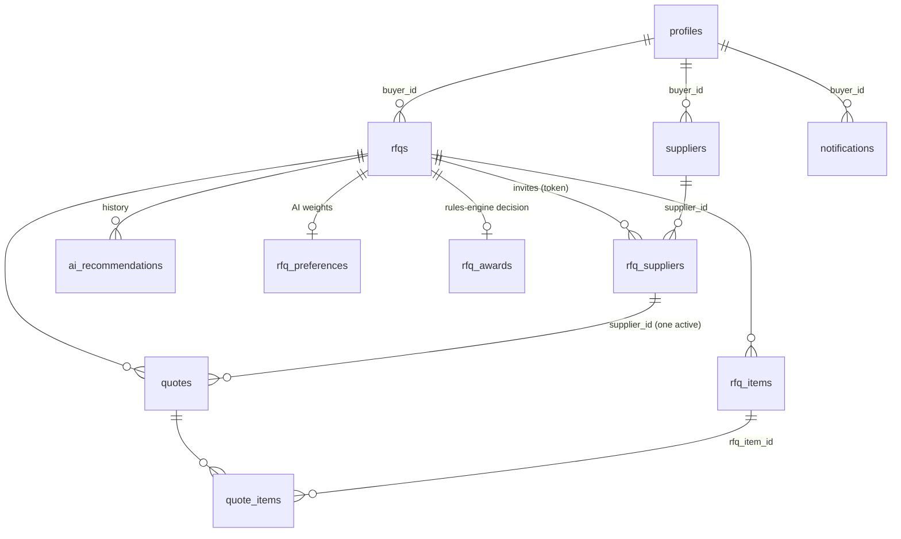
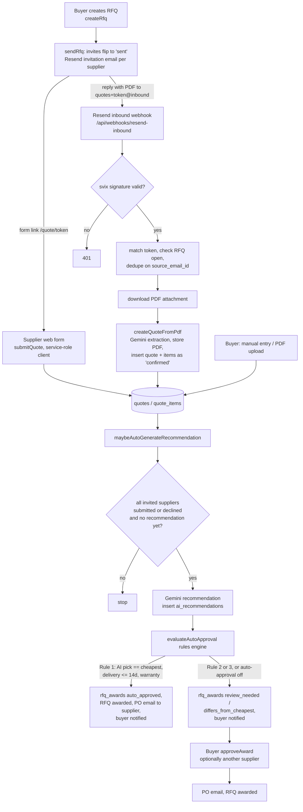

# Clarix architecture

Clarix is a Next.js 14 (App Router) application that runs RFQs (requests for
quotation) end to end: a buyer creates an RFQ, suppliers reply through a
no-login web form or by emailing a PDF, Gemini extracts and compares the
quotes, and a rules engine either auto-approves the winner (sending a PO
email) or flags the RFQ for the buyer's review.

## Stack

| Layer | Choice |
| --- | --- |
| Framework | Next.js 14 App Router, React 18, TypeScript (strict) |
| UI | Tailwind CSS 3, shadcn/ui (Radix), lucide-react, Framer Motion, Recharts |
| Data and auth | Supabase (Postgres + RLS, Auth, Storage bucket `quote-pdfs`) |
| AI | Google Gemini 2.5 Flash through `@google/genai`, structured JSON output validated by Zod |
| Email | Resend: outbound invitations and POs, inbound replies via a signed webhook |
| Hosting | Vercel (serverless functions, middleware on the edge runtime) |
| Tests | Vitest, Testing Library, PGlite (in-process Postgres for migration and RLS tests) |

## Tenancy model

There is no separate organization table. **Each buyer account is its own
tenant**: every business row hangs off `profiles.id` (`rfqs.buyer_id`,
`suppliers.buyer_id`, `notifications.buyer_id`), and child tables
(`rfq_items`, `rfq_suppliers`, `quotes`, `quote_items`, `ai_recommendations`,
`rfq_preferences`, `rfq_awards`) are scoped through an `exists (... rfqs.buyer_id = auth.uid())`
RLS policy. "Scope every query to the user's organization" in this codebase
means "scope it to `auth.uid()`". See `docs/DECISIONS.md` (D-002).

## Data model

`rfq_suppliers` is the per-RFQ invite (it holds the secret `token` for the
supplier form and the inbound email address). `suppliers` is the buyer's
persistent supplier directory, linked lazily by `ensureSupplierProfile`.

## The two quote entry paths

Both entry paths converge on `quotes`. Every path then calls
`maybeAutoGenerateRecommendation`, which only proceeds once every invited
supplier has resolved.

## Request pipeline

* `src/middleware.ts` builds a Supabase server client from cookies and calls
  `auth.getUser()` on every matched request, then redirects logged-out users
  to `/login`.
* Server Components read through `createClient()` (anon key + user cookies,
  so RLS applies).
* Server Actions (`"use server"`) do every write. Buyer actions use the
  RLS-scoped client. The supplier form and the webhook use the service-role
  client (`createAdminClient`), since suppliers never authenticate. The
  token is the credential.

## Risky spots found in recon

| # | Where | Risk | Addressed in |
| --- | --- | --- | --- |
| R1 | `src/middleware.ts` | `await supabase.auth.getUser()` has no timeout. If Supabase Auth is slow, every request hangs until Vercel kills it with `MIDDLEWARE_INVOCATION_TIMEOUT` (504). The matcher also runs it for the public supplier form, the inbound webhook, and every non-image static file. | Phase 1 |
| R2 | Every quote path awaits `maybeAutoGenerateRecommendation` inline | The supplier who submits the last quote waits on a Gemini call plus auto-approval emails (up to 60 s), and a function timeout silently drops the flow. Before PR #1 the supplier form path was fire-and-forget, which serverless runtimes kill. | Phase 1 (durable `jobs` table) |
| R3 | `maybeAutoGenerateRecommendation` | Check-then-insert on `ai_recommendations`: two concurrent final submissions can both pass the "no recommendation yet" check and create two recommendations. | Phase 1 |
| R4 | `evaluateAutoApproval` | Check-then-insert on `rfq_awards`. A concurrent second run fails the insert on the primary key, logs it, then **carries on** to update the RFQ, insert a notification, and send a second PO email. | Phase 1 |
| R5 | `evaluateAutoApproval` | Matches the AI's rank-1 supplier back to a quote by display label (`company_name || email`). Duplicate company names collide, and a label Gemini paraphrases matches nothing, so the run bails silently. | Phase 7 (rule engine rewrite) |
| R6 | Gemini quota errors | Recommendation failures notify the buyer (PR #1), but nothing retries later. | Phase 1 |
| R7 | `tailwind.config.ts` vs `globals.css` | Colors are declared as `hsl(var(--x))` while the variables hold `oklch(...)` values, so shadcn token classes (`bg-background`, `text-muted-foreground`, …) resolve to invalid colors. Pages work only because they use explicit `slate-*` classes. | Phase 10/12 UI pass |
| R8 | `src/lib/email.ts` | User-controlled text (RFQ title, item names, supplier names) is interpolated into email HTML unescaped, which allows HTML injection into emails. | Phase 11 |
| R9 | Inbound webhook | The PDF attachment is fully buffered before the size check, and the content type is trusted from the attachment metadata. | Phase 11 |
| R10 | Public supplier form | No rate limiting on `submitQuote`, and the token page has no throttling. | Phase 11 |
| R11 | `sendRfq` / `createRfq` | Multi-step writes without a transaction (compensating deletes only). Acceptable for now and documented. | n/a |
| R12 | Approval rules | Hard-coded (14 days, warranty required, cheapest only, no spend limit). | Phase 7 |
| R13 | Top bar bell | Shows a permanent red "unread" dot whatever the state is. | Phase 3 |

## Testing approach

* Pure logic (comparison, metrics, scoring, rules, normalization, CSV) is
  unit-tested with Vitest. New logic is written test-first.
* `src/test/db.ts` boots PGlite (Postgres in WASM), stubs Supabase's `auth`
  and `storage` schemas, and applies every migration in
  `supabase/migrations/` in order. Migration tests prove that migrations
  apply and that RLS policies isolate buyers, all without Docker and without
  touching the hosted Supabase project.
* Gemini, Resend, and Supabase clients are mocked in unit tests.
  `src/test/setup.ts` deletes the real API keys from the test environment,
  so a forgotten mock fails loudly instead of calling production.
